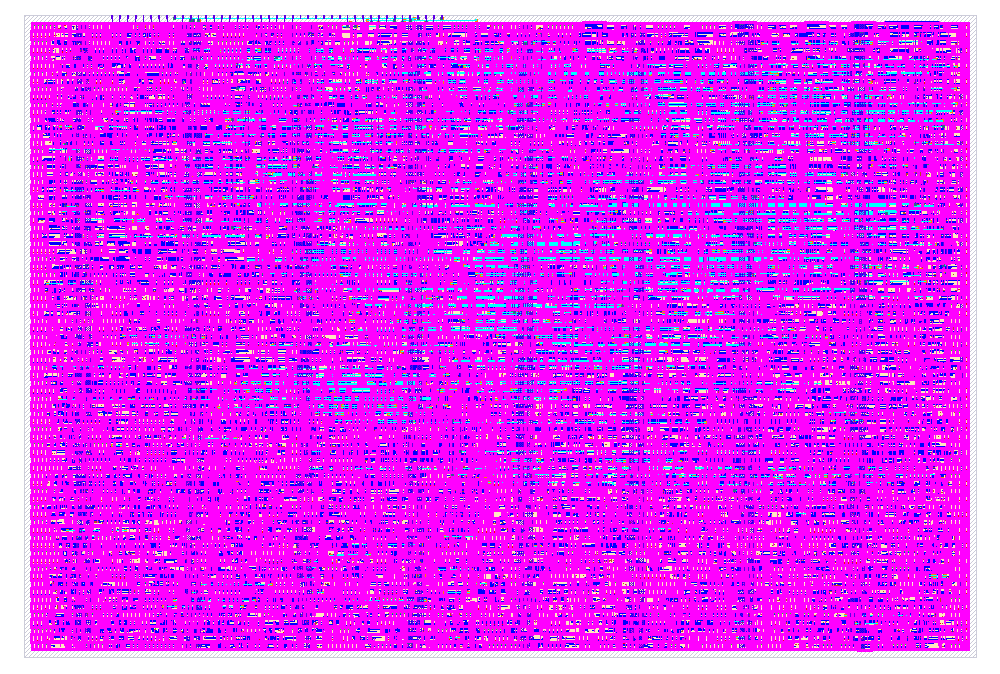

# Toy Attention TPU

A fixed-shape educational attention accelerator designed for a Tiny Tapeout
Sky130 2x2 tile. The chip accepts four 2D signed-int4 tokens and three 2x2
projection matrices, computes Q/K/V and one complete attention head, then
returns four packed result bytes.

The design favors a small, inspectable control flow over throughput. Two
signed-int4 MAC lanes are reused for projections and weighted V; score dot
products serialize through lane 0.

## Attention operation

```text
Q = clamp_int4(X * Wq)
K = clamp_int4(X * Wk)
V = clamp_int4(X * Wv)

scores = Q * K^T
u[j] = max(0, 4 + scores[j] - max(scores))
output = clamp_int4(round((u * V) / sum(u)))
```

Normalization uses a Q0.8 reciprocal lookup table rather than exponential
softmax. The exact arithmetic and byte contract are in
[`TPU/docs/toy_attention_spec.md`](TPU/docs/toy_attention_spec.md).

## Run locally

Requirements:

- Python 3.10 or newer
- Icarus Verilog (`iverilog` and `vvp`)
- GNU Make

On macOS, install Icarus once and run the complete model/RTL regression:

```bash
brew install icarus-verilog
cd TPU
make setup
make verify
```

`make verify` runs 18 Python tests, the historical standalone PE check, and
two complete wrapper-level attention transactions generated from the Python
golden model. Final bytes and all debug response classes are compared.

Print the reference model trace:

```bash
cd TPU
.venv/bin/python toy_attention.py
```

## Run cocotb at the Tiny Tapeout pins

From the repository root:

```bash
python3 -m venv .venv-tt
source .venv-tt/bin/activate
python -m pip install -r test/requirements.txt
cd test
make
```

The cocotb suite drives the same byte protocol intended for a physical host and
checks prerequisites, backpressure, debug reads, invalid commands, and
`FLUSH`. Powered gate-level simulation additionally requires `PDK_ROOT` and a
generated `test/gate_level_netlist.v`:

```bash
cd test
make GATES=yes
```

## Repository map

| Path | Purpose |
| --- | --- |
| `src/dual_int4_mac.v` | Two signed-int4 MAC lanes with signed-int16 sums |
| `src/toy_attention_core.v` | Storage, byte protocol, controller FSM, and attention datapath |
| `src/project.v` | Tiny Tapeout top-level wrapper and pin mapping |
| `TPU/toy_attention.py` | Exact NumPy golden model and traces |
| `TPU/sim/tb_toy_attention.v` | Icarus end-to-end transaction checker |
| `test/test.py` | Tiny Tapeout wrapper-level cocotb tests |
| `info.yaml` | Project metadata, 2x2 tile allocation, clock, sources, and pins |
| `src/config.json` | 10 MHz LibreLane hardening configuration |

The earlier experiments under `TPU/rtl/rtl/` are intentionally excluded from
the Tiny Tapeout source list. The tapeout implementation consists only of the
three modules listed in `info.yaml`.

## Walkthrough and evidence

- [Interactive end-to-end walkthrough](planning/toy-transformer-chip/sections/e2e-walkthrough.html)
- [Implemented high-level architecture](planning/toy-transformer-chip/sections/high-level-architecture.html)
- [Design roadmap](planning/toy-transformer-chip/sections/design-roadmap.html)
- [Tapeout verification evidence](TPU/docs/tapeout_verification.md)



The current local result uses 65.043% of the Tiny Tapeout placement area and
meets 10 MHz with no setup or hold violations. Source RTL and the powered
post-layout netlist pass the same cocotb tests, and all applicable Tiny Tapeout
prechecks pass. Non-fatal maximum-slew warnings remain documented for review
before shuttle submission.
